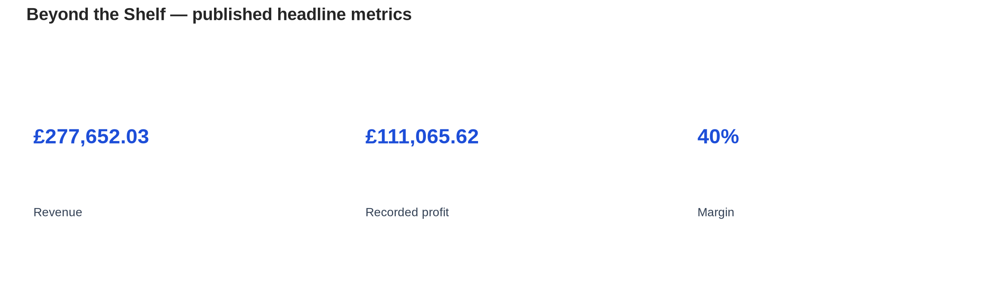
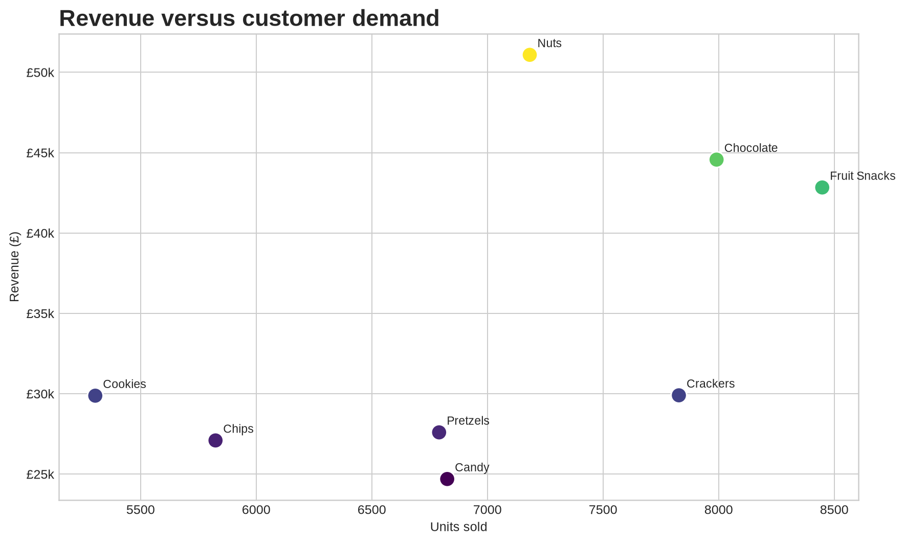
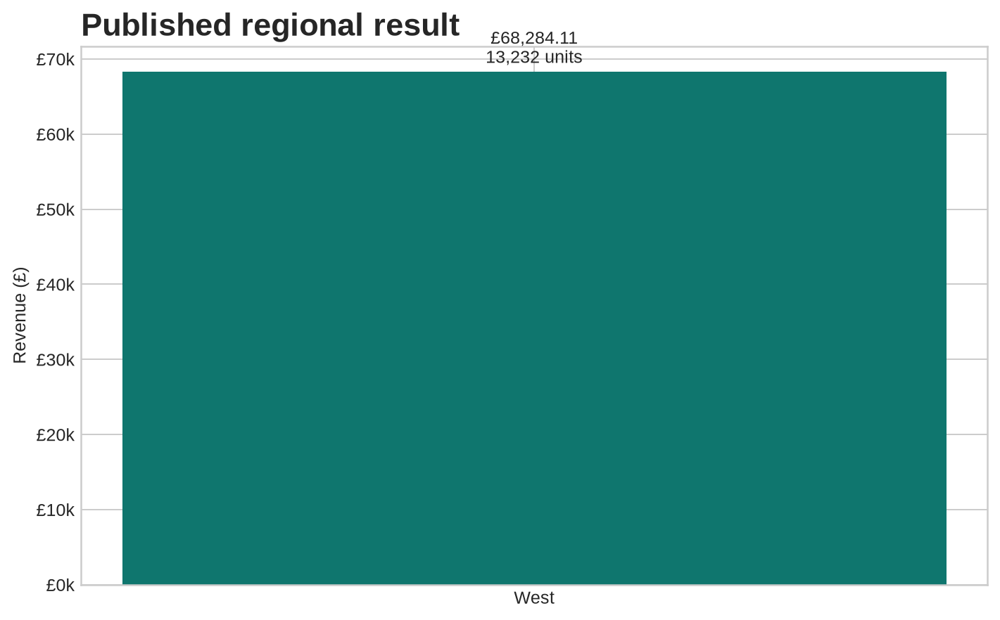

# Beyond the Shelf: Power BI Sales Performance Analysis

A professional, reproducible companion repository for Christian Iyayi's Power BI case study, **“Beyond the Shelf: Insights from a Power BI Sales Performance Analysis.”** The project explores revenue, recorded profit, product demand, regional performance, customer satisfaction, and how better questions lead to more useful business intelligence.

> **Source report:** [Beyond the Shelf: Insights from a Power BI Sales Performance Analysis](https://medium.com/@krisnice2002gmail.com/beyond-the-shelf-insights-from-a-power-bi-sales-performance-analysis-9e601d430cb1)

## Published headline metrics

| Metric | Value |
|---|---:|
| Sales records | 200 |
| Units sold | 56,195 |
| Revenue | £277,652.03 |
| Recorded profit | £111,065.62 |
| Recorded profit margin | 40% |
| Average selling price | 4.94 per unit |
| Product categories | 8 |
| Recorded brands | 10 |
| Regions | 5 |

## Key findings

- **Nuts** generated the highest category revenue: **£51,084.92** from **7,183 units**.
- **Fruit Snacks** led volume with **8,448 units**, ahead of Chocolate at **7,991 units**.
- Nuts, Chocolate, and Fruit Snacks together contributed approximately half of total revenue.
- **West** led regional performance with **£68,284.11** in revenue, **24.6%** of total revenue, and **13,232 units** sold.
- Strong regions can provide benchmarks for product mix, customer behavior, and promotional practices, while lower-performing regions may benefit from localized campaigns and product offers.

## Derived visual summary







## Repository contents

- [`docs/report.md`](docs/report.md) — clean transcription of the report’s substantive content with source attribution.
- [`data/category_performance.csv`](data/category_performance.csv) — category figures published in the article.
- [`data/regional_performance.csv`](data/regional_performance.csv) — West regional figures published in the article.
- [`src/analysis.py`](src/analysis.py) — reproducible Python script for regenerating the visuals.
- [`docs/power-bi-notes.md`](docs/power-bi-notes.md) — suggested Power Query, DAX, and report-page structure.
- [`assets/`](assets/) — derived charts based only on published article figures.

## Reproduce the visuals

```bash
python3 -m pip install matplotlib pandas
python3 src/analysis.py
```

The script does not require the underlying private Excel workbook.

## Scope and attribution

This is a companion repository, not the original Power BI workbook. The article publishes aggregate results but not the complete row-level Excel data, full regional table, brand table, monthly table, or original dashboard file. The visuals in this repository are therefore **derived visualizations** based on the figures publicly stated in the article.

The original article and its imagery remain the property of the original author. See [`docs/report.md`](docs/report.md) and [`assets/README.md`](assets/README.md) for attribution and image notes.

## License

The analytical code and repository structure are released under the MIT License. The report text and original article imagery remain subject to their original rights.
